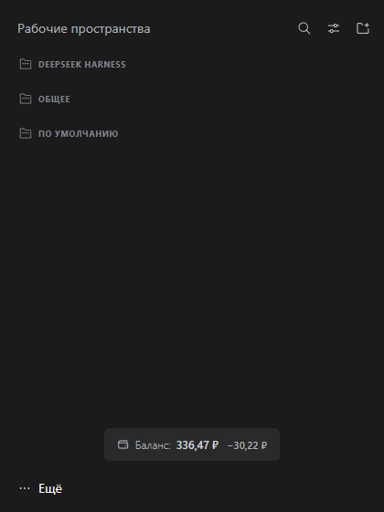

# dsh-routerai-balance

[Русский](#русский) · [English](#english)

---

## Русский

Плагин для [DeepSeek Harness](https://github.com/deepseek-ai/deepseek-harness): баланс **RouterAI** и расход с начала сессии внизу боковой панели.



### Что показывает

- **Баланс** — сколько средств осталось на счёте RouterAI.
- **Расход** — сколько списано с момента запуска сессии.

### Настройка

На странице плагина (**Плагины → Баланс RouterAI**) есть поле **«RouterAI · интервал обновления баланса»**: от 5 до 300 секунд, по умолчанию 10. Баланс тратится постоянно, поэтому счёт здесь идёт на секунды.

### Требования

- Ключ API RouterAI в учётных данных harness под именем `ROUTERAI_API_KEY`.

Без него плагин молчит и показывает `—`.

### Установка

**Магазин.** Плагины → Plugin Market → найдите `dsh-routerai-balance`.

**Кнопка «Добавить плагин».** Плагины → Добавить плагин:

```
github:dev-cmde/dsh-routerai-balance
```

**Командная строка.** Приложение использует профиль `desktop`, веб-версия — `web`:

```sh
# приложение
dsh plugin --profile desktop add github:dev-cmde/dsh-routerai-balance

# веб-версия
dsh plugin --profile web add github:dev-cmde/dsh-routerai-balance
```

### Лицензия

MIT — см. [LICENSE](LICENSE).

---

## English

A [DeepSeek Harness](https://github.com/deepseek-ai/deepseek-harness) plugin: your **RouterAI** balance and the spend since the session started, in the sidebar footer.


### What it shows

- **Balance** — how much credit is left on the RouterAI account.
- **Spend** — how much has been used since the session started.

### Configuration

The plugin page (**Plugins → RouterAI balance**) has a **RouterAI · balance refresh interval** field: 5 to 300 seconds, 10 by default. Credit is spent continuously, so this one counts in seconds.

### Requirements

- A RouterAI API key stored in the harness credentials as `ROUTERAI_API_KEY`.

Without it the plugin stays silent and shows `—`.

### Installation

**Plugin market.** Plugins → Plugin Market → search for `dsh-routerai-balance`.

**The "Add plugin" button.** Plugins → Add plugin:

```
github:dev-cmde/dsh-routerai-balance
```

**Command line.** The desktop app uses the `desktop` profile, the web version uses `web`:

```sh
# desktop app
dsh plugin --profile desktop add github:dev-cmde/dsh-routerai-balance

# web version
dsh plugin --profile web add github:dev-cmde/dsh-routerai-balance
```

### License

MIT — see [LICENSE](LICENSE).
